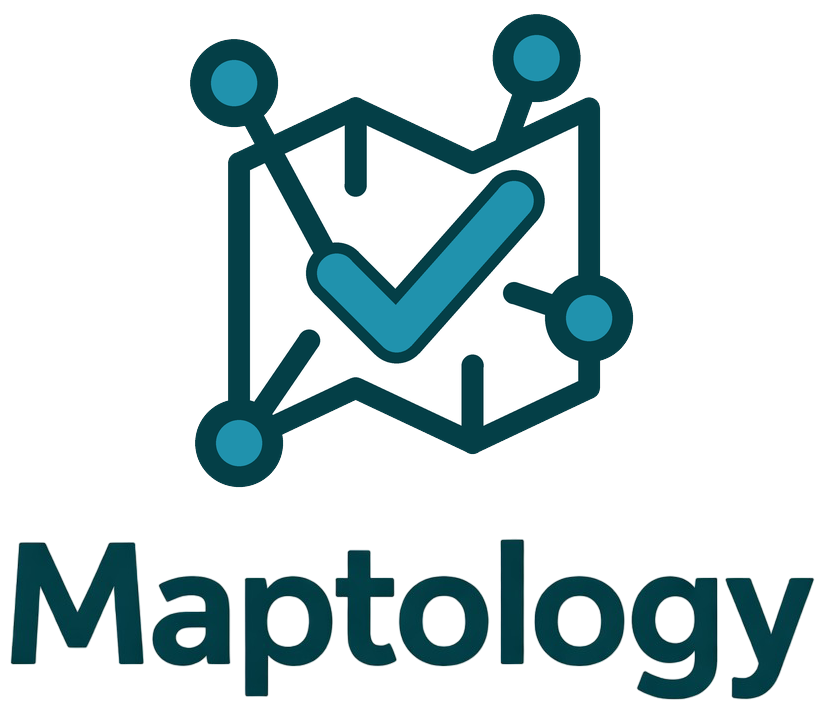

**Maptology** is a web application built with the Python [Streamlit](https://en.wikipedia.org/wiki/Streamlit) framework. It helps researchers document the meaning of columns and values in [tabular data files](https://en.wikipedia.org/wiki/Table_(information)) ([CSV](https://en.wikipedia.org/wiki/Comma-separated_values), [TSV](https://en.wikipedia.org/wiki/Tab-separated_values), and [Excel](https://en.wikipedia.org/wiki/Microsoft_Excel) files) by linking them to standardized scientific vocabulary.

People who create tabular data files (lab technicians, researchers, data analysts, and others) each tend to describe concepts in their own ways. Without the original creator to explain these choices, deciphering what a column or value actually represents can be slow and error prone. Maptology solves this by enabling data users to map each column name and categorical value to a matching term from an [ontology](https://en.wikipedia.org/wiki/Ontology_(information_science)), where every concept has a precise definition and a stable identifier. This shared vocabulary makes it possible to compare and combine datasets from different labs or studies, which improves data [interoperability](https://en.wikipedia.org/wiki/Interoperability).

To illustrate, consider the scenario of a researcher studying gene-expression profiles in liver tumors. They might obtain phenotypic data from a local source, such as [electronic health records](https://en.wikipedia.org/wiki/Electronic_health_record), or from a public source, such as [Gene Expression Omnibus](http://www.ncbi.nlm.nih.gov/geo/). A common field to include in such a study is the subjects' biological sex assigned at birth. This information might be stored in a column named `Sex` or even something more generic like `characteristic_1`. The values in this column might include "F" and "M" or "Female" and "Male". A human examining these data might be able to infer what they mean based on intuition. However, assigning ontology terms would make the data more explicit and would avoid ambiguity. By mapping ontology term(s) to each column and unique value, it would become possible for both humans and computers to infer semantics. Rather than modifying the column name itself, which could cause confusion about [data provenance](https://en.wikipedia.org/wiki/Data_lineage#Data_provenance), we could provide a companion document that indicates the mappings. For example, we might use the [biological sex](http://purl.obolibrary.org/obo/PATO_0000047) term from the [Experimental Factor Ontology](https://en.wikipedia.org/wiki/Experimental_factor_ontology) (EFO) to describe the overall column and the [female](http://purl.obolibrary.org/obo/PATO_0000383) and [male](http://purl.obolibrary.org/obo/PATO_0000384) terms from EFO to describe the "F" and "M" values, respectively.

Even if a dataset is *not* being shared with others, mapping the data to ontology terms is valuable because it benefits the original researchers and others on their team. Researchers inevitably revisit datasets months or years later, projects change hands, and analyses are combined across studies. Recording the intended meaning of columns and their values reduces ambiguity, improves reproducibility, and makes it easier to integrate data from multiple sources.

The Maptology app enables researchers to import tabular data files, choose one or more ontologies, map column names and data values to terms within the selected ontologies, specify the basic data type (e.g., string, integer, float, date/time), and export this information as [LinkML](https://linkml.io) and/or [SSSOM](https://mapping-commons.github.io/sssom/dev) files. In doing so, it uses the [TF/IDF methodology](https://en.wikipedia.org/wiki/Tf%E2%80%93idf) to suggest mappings and enables the user to employ their domain expertise to accept or reject suggested mappings and perform custom searches. These searches are fast, even for large ontologies. No coding is required by the user. Additionally, Maptology supports the ability to map multiple ontology terms to a column name or data value. This is important because in many instances, a single ontology term is not descriptive enough on its own.

Although other tools exist for mapping text to ontology terms (e.g., [text2term](https://github.com/rsgoncalves/text2term), [Zooma](https://www.ebi.ac.uk/spot/zooma/), [BioPortal Annotator](https://bioportal.bioontology.org/annotator)), these are designed for free text, while Maptology is designed specifically for tabular files which are ubiquitous in research.

## How it works

#### Step 1: Upload Data File

Upload a tabular data file in CSV, TSV, or Excel format. Column names in the file should be unique. Maptology holds your file and mappings in session memory while you work; it does not write them into a permanent data store.

#### Step 2: Preview Data

Review the uploaded table to confirm it was read correctly.

#### Step 3: Import Existing Mappings (Optional)

If you already have a Maptology [LinkML](https://linkml.io) or [SSSOM](https://mapping-commons.github.io/sssom/dev) export, import it here to continue from those mappings. Only mappings that match the current data file are kept. You can skip this step.

#### Step 4: Select Ontologies

Choose one or more ontologies to search when mapping columns and values.

#### Step 5: Map Ontology Terms for Columns

Select each column, confirm or change its basic data type (for example, string, integer, float, or date/time), and map it to one or more ontology terms. Maptology suggests matches with [TF/IDF](https://en.wikipedia.org/wiki/Tf%E2%80%93idf); you can accept or reject those suggestions or run your own searches.

#### Step 6: Map Ontology Terms for Values

For string columns, map unique data values to ontology terms the same way. This step does not apply to number, date, or time columns.

#### Step 7: Download Results

Export your mappings as LinkML and/or SSSOM files, along with CSV summaries of the column and value mappings.

## Getting Started

### Try it on our web server

You can try Maptology at
[https://bioapps.byu.edu/maptology](https://bioapps.byu.edu/maptology).

Uploaded files and the mappings you create are held in the server's session
memory while you use the app. Maptology does not save them to a permanent
database or file archive on our side. When your session ends, that working
copy is gone.

### Run it on your own computer with Docker

To run Maptology locally, use [Docker](https://docs.docker.com/get-docker/).
The repository includes scripts that build the image and start the container
for you.

#### 1. Get a BioPortal API key

Maptology searches ontologies locally, which is what makes it fast, but those
local search indexes have to be built from the ontologies themselves first.
Maptology downloads them from [BioPortal](https://bioportal.bioontology.org),
which requires a free API key.

1. Create a free account at
   [bioportal.bioontology.org/accounts](https://bioportal.bioontology.org/accounts)
   and copy your API key.
2. Make the key available before you start the container:

   ```
   # macOS / Linux
   export BIOPORTAL_APIKEY=your-key-here
   # Windows Command Prompt
   set BIOPORTAL_APIKEY=your-key-here
   # Windows PowerShell
   $env:BIOPORTAL_APIKEY = "your-key-here"
   ```

   You can also replace the `<YOUR_API_KEY>` placeholder in `docker-run.sh`
   (macOS / Linux) or `docker-run.bat` (Windows).

Your key stays on your computer. Maptology does not send it anywhere except to
BioPortal, and it is only used to download and update ontologies, not while you
are searching or mapping.

#### 2. Clone the repository and start Docker

```
git clone https://github.com/gy-hwang97/Maptology.git
cd Maptology
```

Then start the app with the script for your operating system:

```
# macOS / Linux
bash docker-run.sh

# Windows
docker-run.bat
```

When the container is ready, open
[http://localhost:8501](http://localhost:8501) in your browser. The scripts
rebuild the image each time they run.

## Additional configuration (optional)

The Docker scripts support additional configuration values that can be specified optionally. However, the app works fine with defaults for these. Modify the settings only when you want a different download mode or a different URL path for the app.

These settings are [environment variables](https://en.wikipedia.org/wiki/Environment_variable): named values your shell passes into the Docker scripts, which then pass them into the container. You can set them in multiple ways. One is to set them in the same terminal session *before* you run `docker-run.sh` or `docker-run.bat`, following the `export`, `set`, or
`$env:...` shown below. An environment variable set this way lasts for that terminal session; if you start a new terminal session, you will need to specify them again.

You can also change the defaults inside the scripts themselves: edit `MAPTOLOGY_DOWNLOAD_ALL` or `MAPTOLOGY_BASE_PATH` near the top of `docker-run.sh` (macOS / Linux) or `docker-run.bat` (Windows).

### Downloading ontologies

**The Docker scripts download all available ontologies by default**
(`MAPTOLOGY_DOWNLOAD_ALL=yes`). This configuration suits a server installation, where users might want to use many different ontologies. When Maptology first starts, it downloads and indexes all available ontologies
before the Maptology app can be opened in a browser; later starts only fetch files that are missing or out
of date. If the ontologies on disk are ready to go, the page opens immediately and the BioPortal check continues in the background. While the app stays running, BioPortal is re-checked every 30 days and any changes are fetched
automatically, so a long-running server needs no manual updates.

What a full download costs, measured once from a clean machine:

| | |
|---|---|
| Ontologies | ~1,000 |
| Downloaded | **~15 GB** of ontology files |
| Search indexes built from them | **~1.6 GB** |
| Time spent downloading | **~30 minutes** |
| Time spent building indexes | **~75 minutes** |

The two phases overlap — indexing starts on each ontology as soon as its file arrives, so the run does not cost the sum of those two figures. It costs roughly the longer of them.

Two things are worth knowing before you start a full download.

**A faster internet connection may not help much.** In our tests, a single connection to BioPortal moved about 4.7 MB/s, whereas it downloaded 12.4 MB/s over four connections and 15.4 MB/s over eight. These tests were run on one machine on a particular network in South Korea; your mileage may vary.

**Building the indexes takes longer than downloading them** — about two and a half times as long in our measurements. The cost comes from the number of ontologies rather than their size, because each one carries a fixed start-up cost; the very large ones are only a couple of minutes apiece.

Progress is echoed to the terminal, and the app opens once processing has finished. You can stop it at any point; Maptology runs with whatever it has already built and fetches the rest on demand. Later starts only fetch what
changed. A few ontologies are available in formats that Maptology cannot read; those are skipped.

Requests are spaced out to stay within BioPortal's published rate limit of 15 requests per second.

**To fetch ontologies only as you need them instead**, set `MAPTOLOGY_DOWNLOAD_ALL=no` before running the script:

```
# macOS / Linux
export MAPTOLOGY_DOWNLOAD_ALL=no
# Windows Command Prompt
set MAPTOLOGY_DOWNLOAD_ALL=no
# Windows PowerShell
$env:MAPTOLOGY_DOWNLOAD_ALL = "no"
```

With this setting, the app will open almost immediately. Within the app, you can download ontologies as you
need them. This only takes a few seconds for most ontologies, or a minute or two for the largest ones. Once an ontology is on your machine, searching it requires no network connection. Ontologies you previously downloaded are checked against BioPortal at most once every 30 days.

### Serving at the root or under a URL prefix

When you run Maptology, the `MAPTOLOGY_BASE_PATH` environment variable controls the URL path the app is served from. Leave it empty (or unset) to run at the web server root. If you would like Maptology to run under a prefix (such as https://myserver.com/maptology), you can specify the prefix using this variable. This is often helpful if you run the app behind a reverse proxy.

```
# Serve at the web server root (e.g. https://www.maptology.com)
# macOS / Linux
export MAPTOLOGY_BASE_PATH=""
# Windows Command Prompt
set MAPTOLOGY_BASE_PATH=
# Windows PowerShell
$env:MAPTOLOGY_BASE_PATH = ""

# Serve under a URL prefix (e.g. https://myserver.edu/maptology)
# macOS / Linux
export MAPTOLOGY_BASE_PATH=/maptology
# Windows Command Prompt
set MAPTOLOGY_BASE_PATH=/maptology
# Windows PowerShell
$env:MAPTOLOGY_BASE_PATH = "/maptology"
```